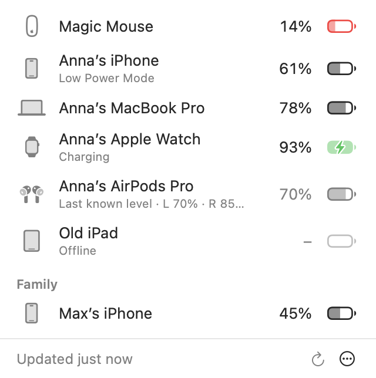

# Batteri

The battery level of all your Apple devices, in the Mac menu bar.

<picture>
  <source media="(prefers-color-scheme: dark)" srcset="docs/panel-dark.png">
  
</picture>

Find My knows how much charge is left in your iPhone, iPad, Apple Watch and Mac, but only
shows it as a small icon. Batteri puts the same numbers one click away, lowest first, together
with the keyboard, mouse and AirPods your Mac knows about.

Batteri is free and open source. It is not available on the Mac App Store, and it is not
affiliated with Apple.

## Getting started

1. Download `Batteri.zip` from the [latest release](https://github.com/gunnarr/batteri-menu/releases/latest)
   and move Batteri to your Applications folder.
2. Open it. Batteri lives in the menu bar; the first time, a window asks you to sign in.
3. Sign in with your Apple Account and the six-digit code that appears on your devices.

That is all. There is nothing else to install: the app contains everything it needs.

Requires macOS 14 or later on a Mac with Apple silicon.

## What you see

- **iPhone, iPad, Apple Watch and Mac** come from iCloud, the same source Find My uses.
- **AirPods** are not reported by iCloud. Batteri shows the level your Mac saw the last time
  they were connected to it, marked *Last known level*. It can be out of date.
- **Keyboard, mouse and trackpad** connected to this Mac show their current level.
- Devices that are switched off, or that report nothing, are listed as *Offline*.

In Settings you can open Batteri at login, show the lowest level next to the menu bar icon,
choose how often to refresh, and include the devices of your Family Sharing group.

## Privacy and security

- Your password is used once, to sign in to Apple's iCloud service. It is never stored.
- After signing in, a session is saved in `~/.config/batteri/` on your Mac, readable only by
  you. Anyone who can read those files can reach your iCloud account on the web, so treat the
  folder as a secret. *Settings → Sign Out* removes it.
- Batteri talks to Apple and to nothing else. There are no analytics and no accounts.
- Checking the batteries can never start a new sign-in on its own.

## Limitations

- Batteri relies on the interface behind icloud.com/find, which is not an official API. Apple
  can change it at any time, and Batteri will then stop working until it is updated.
- Accounts that require a physical security key are not supported.
- Charging is shown for devices that report it through iCloud, not for keyboards and mice.

## How it works

The app is written in Swift and SwiftUI. Talking to iCloud is done by
[batteri](https://github.com/gunnarr/batteri), a small command-line tool built on
[pyicloud](https://github.com/timlaing/pyicloud). A private copy of Python with that tool is
bundled inside the app, and the app runs it to fetch the devices and to sign in. If you prefer
the terminal, the command-line tool works on its own, and the two share the same sign-in.

## Building from source

You need Xcode and [uv](https://docs.astral.sh/uv/) (`brew install uv`).

```
git clone https://github.com/gunnarr/batteri-menu
cd batteri-menu
make test    # unit tests
make run     # build Batteri.app with the engine inside, and open it
```

Other targets: `make install` copies the app to /Applications, `make screenshots` renders
the images in `docs/` from made-up devices, and `make release` builds a zip signed with your
own Developer ID (set `SIGN_ID` in `release.mk`).

The engine version that ships in the app is pinned in `engine.version`.

```
Sources/BatteriCore   models, the engine client and all wording – no UI, fully tested
Sources/Batteri       the menu bar item, the sign-in window and Settings
scripts               bundling the engine and rendering the icon
```
